<p align="center">
  
</p>

<h1 align="center">Edlics-Plus</h1>

<p align="center">
  <strong>浏览器里的 VSCode 式 IDE + 轻量 Linux 管理面板 —— 编辑器 · 文件树 · 搜索 · Git · 终端 · 系统控制台</strong>
  <br>
  一行命令把你的服务器变成网页 IDE，打开浏览器即可开发与运维。
</p>

<p align="center">
  <a href="SETUP.md"></a>
  <a href="SETUP.md"></a>
  <a href="#快速开始"></a>
  <a href="#开发上手"></a>
  <a href="LICENSE"></a>
</p>

<br>

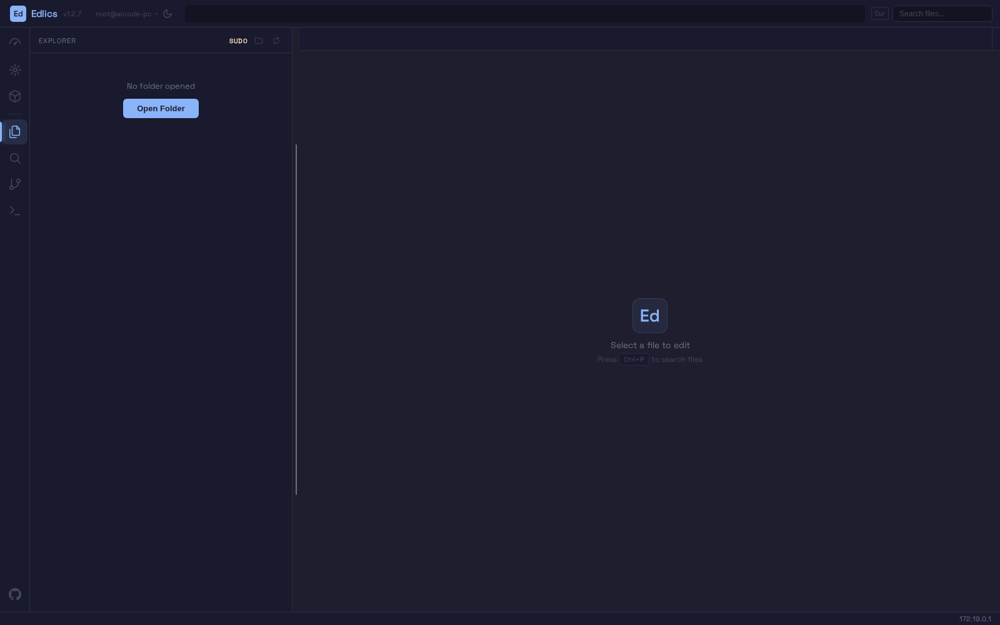

<br>

## 解决什么问题

你有一台 Linux 服务器（比如 AWS EC2），需要编辑配置文件、写代码或排查问题。通常你要 SSH 登录、在终端里用 `vim`、记快捷键、没法用鼠标、看不到目录结构——能用，但很麻烦。

**Edlics-Plus 把服务器变成一个网页版 VSCode**：运行一条命令，浏览器打开一个 URL，你就得到完整的文件树、语法高亮编辑器、全文搜索、Git 面板和**真实终端**。除了初始安装，不需要任何 SSH 技能。

再加上可选的 **系统控制台**（`--admin`），同一个界面里还能看指标曲线、管 systemd 服务、查网络/磁盘/日志、操作 Docker 容器——不必在 IDE 和另一个管理面板之间来回切换。

<br>

## 快速开始

```bash
npx edlics-plus serve --hostname 0.0.0.0 --port 5000 --password '你的密码'
# 需要内置终端时追加 --terminal（默认关闭，风险见「安全说明」）
# 需要系统控制台时追加 --admin（写操作再加 --admin-write）
```

浏览器打开 `http://localhost:5000`（远程服务器则是 `http://服务器IP:5000`），**输入密码登录**后：

1. 点击左上角 **Open Folder**，在根目录范围内打开一个工程文件夹（记住在 localStorage，刷新不丢）
2. 左侧活动栏切换：**Dashboard | System | Containers | Explorer | Search | Git | Terminal**
3. 点文件编辑、`Ctrl+Shift+F` 全文搜索、Git 面板看变更和时间线、Terminal 页敲命令

限制文件操作范围 / 只读模式：

```bash
npx edlics-plus serve --hostname 0.0.0.0 --port 5000 --root /var/www --password '你的密码'
npx edlics-plus serve --hostname 0.0.0.0 --port 5000 --readonly
```

> 密码省略时会**自动生成并打印**在启动日志里；也可用环境变量 `EDLICS_PASSWORD`。
> 详见 [SETUP.md](SETUP.md)（所有安装方式、密码策略、故障排查）。

<br>

## 截图

### 系统控制台（`--admin`）

**Dashboard** —— 12 张信息卡（CPU 虚拟化识别、内存/交换/负载/磁盘占用圆环）+ 实时曲线 + 进程表：

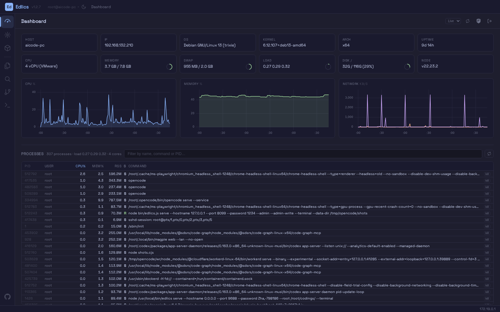

| | |
|---|---|
| **Services —— unit 文件 / 日志** | **Interfaces —— 地址、路由、端口表格** |
| 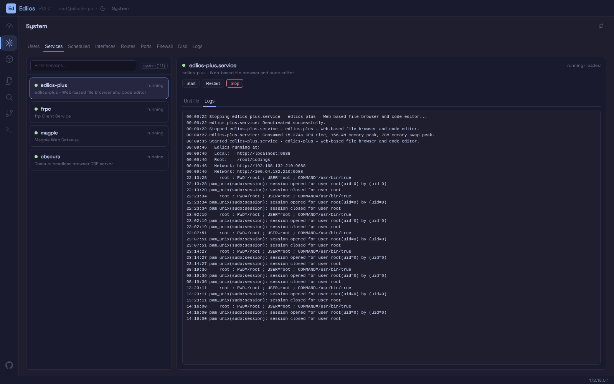 | 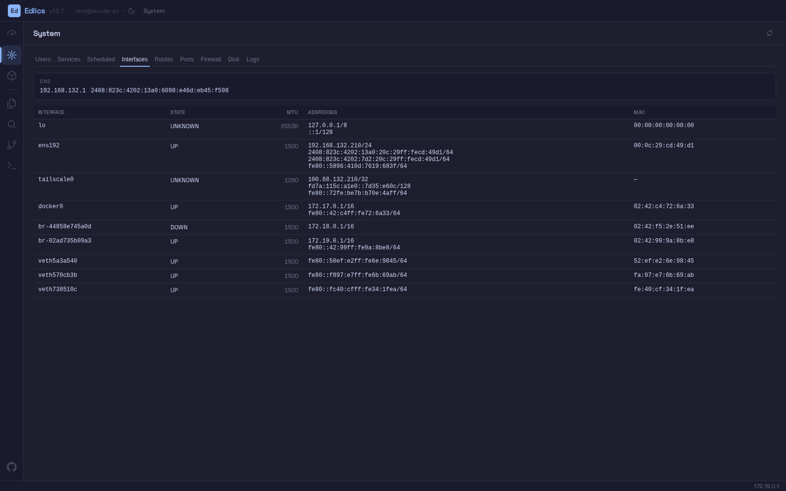 |
| **Disk —— 分区占用 + 块设备** | **Logs —— 按来源/时间/级别/关键词过滤** |
| 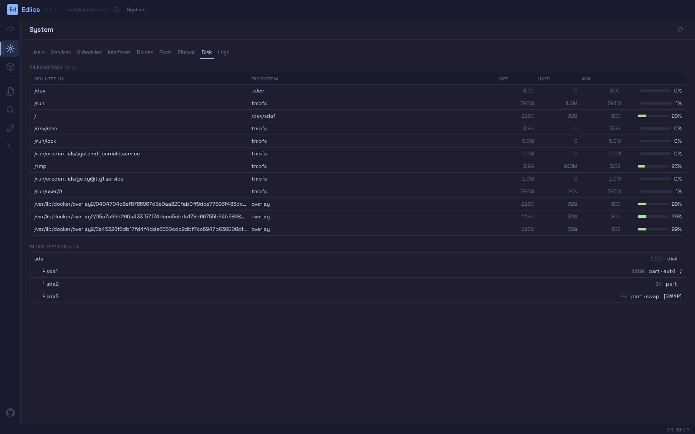 | 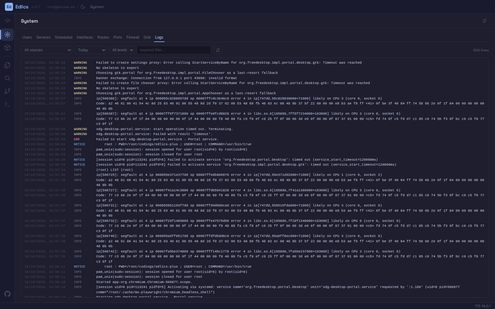 |

**Containers** —— 状态化操作、端口下拉、日志与容器内 shell、compose 文件查看：

| | |
|---|---|
| 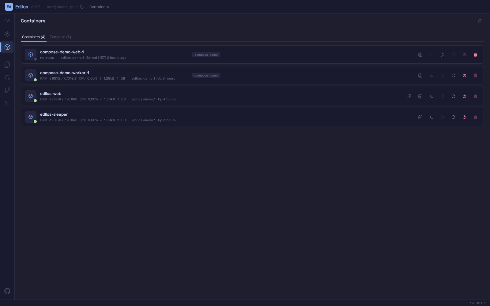 | 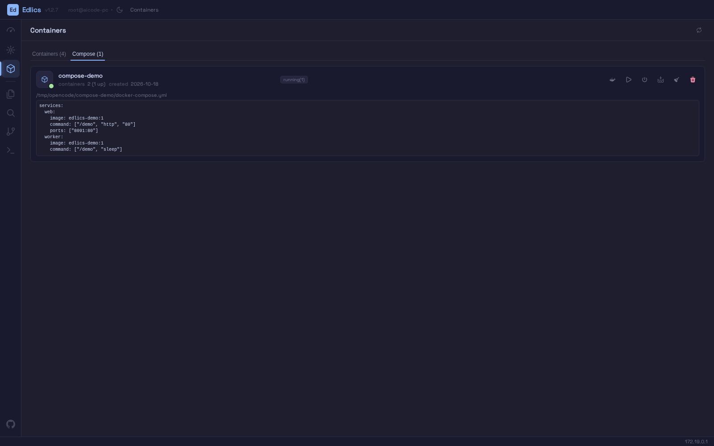 |

### 编辑器与开发

| | |
|---|---|
| **文件树 + 编辑** | **全文搜索** |
|  | 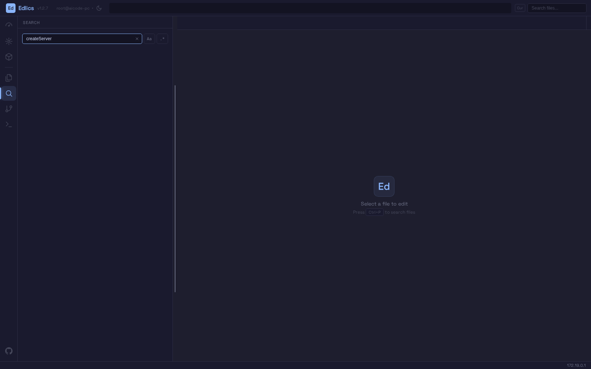 |
| **Git 变更 + Diff** | **提交时间线 Graph** |
| 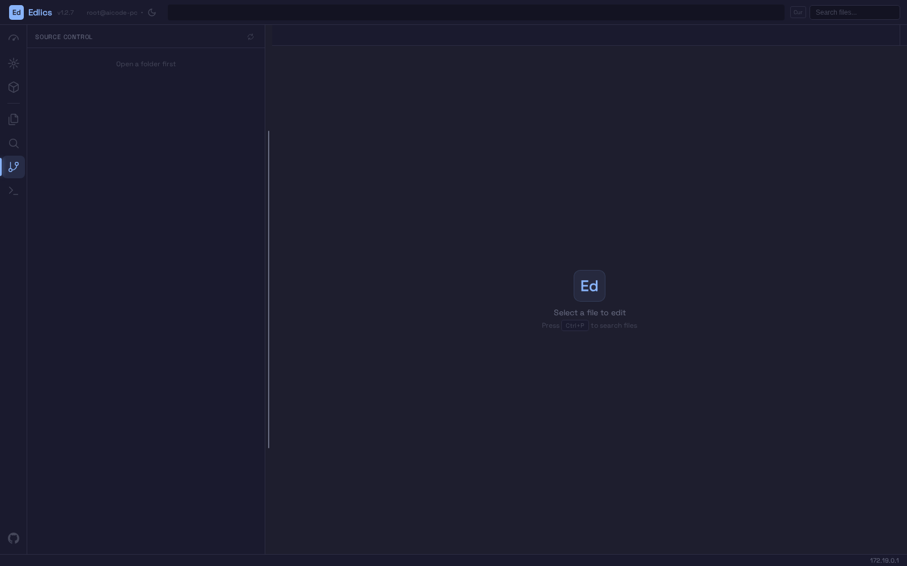 | 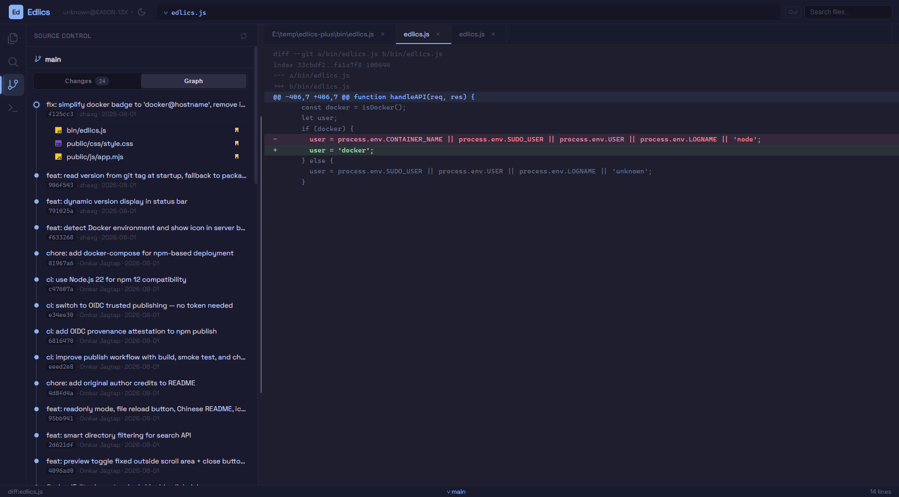 |
| **PTY 终端（独立页）** | **两步验证设置** |
| 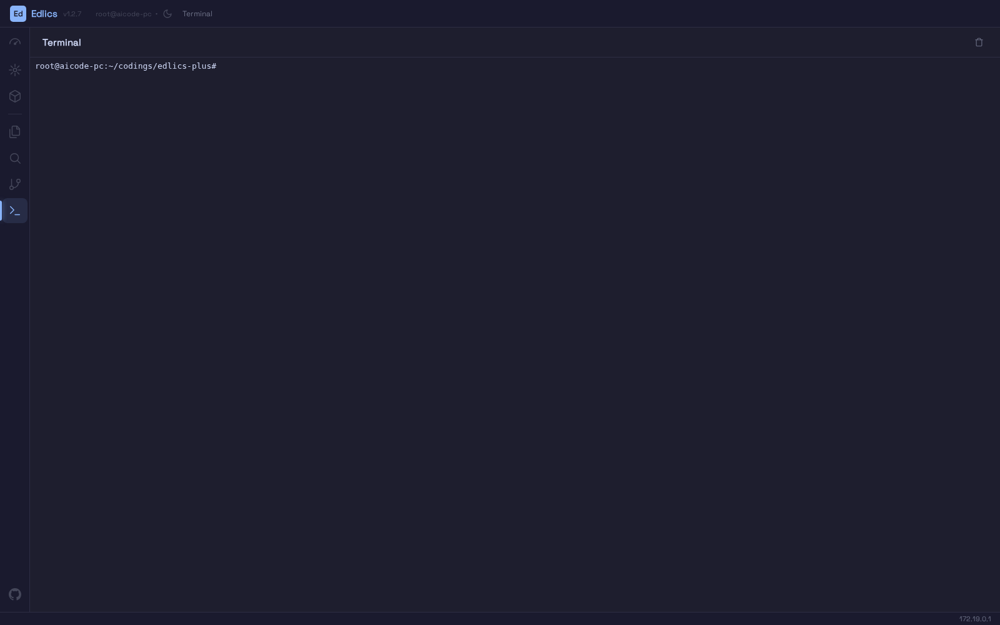 | 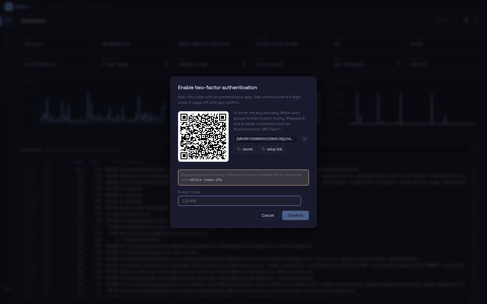 |

**登录** —— 独立登录页（连续输错 5 次锁定 15 分钟；HttpOnly 会话空闲 7 天滑动续期、30 天绝对上限，重启不掉线；可叠加 TOTP 两步验证）：


> 点击工具栏的 🌙 / ☀ 图标可一键切换 **深色 / 浅色主题**，编辑器、终端与全部面板同步换肤。

<br>

## 功能特性

### 界面与工作区

| | |
|---|---|
| **密码登录** | 强制认证才能进入；sha256 恒时比较、5 次失败锁 15 分钟、HttpOnly 会话（滑动 7 天 / 上限 30 天，落库持久化） |
| **活动栏（VSCode 式）** | 最左侧图标条切换 文件树 / 搜索 / Git / 终端，激活态高亮指示 |
| **工程文件夹（工作区）** | 在 `--root` 范围内打开一个项目目录，localStorage 记住，刷新自动恢复 |
| **可折叠文件树** | VSCode 式懒加载展开/收起，Material Design 图标（600+），隐藏文件淡化 |
| **标签页编辑器** | CodeMirror 6，14 种语言语法高亮，单击预览/双击固定，标签滚动与右键菜单 |
| **深色 / 浅色主题** | 一键切换，编辑器/终端/全部面板同步换肤，偏好本地保存 |
| **状态栏** | 用户@主机、当前分支、行号与修改状态、服务器 IP |

### 搜索

| | |
|---|---|
| **全文内容搜索** | `Ctrl+Shift+F`，整个工作区搜文本，结果按文件分组、命中高亮、Aa/.* 开关 |
| **点击跳转** | 点击任意命中行直接打开文件并定位到行列 |
| **文件名快搜** | `Ctrl+P` 顶栏按文件名过滤，自动排除 `node_modules`/`target` 等构建目录 |


### Git 面板

| | |
|---|---|
| **Changes 列表** | 分支名 + 变更文件（文件图标 + 右对齐 M/U/A/D 单字母状态，VSCode 风格），点击直接看 **diff** |
| **Graph 时间线** | 单线时间线展示提交历史（HEAD 空心大点、历史实心蓝点），点击提交展开改动文件，再点文件看该次提交的 **diff** |
| **只读安全** | 全部走 `execFile` 无 shell 注入，sha 白名单校验，workspace 必须位于 root 内 |


### 终端（真 PTY）

> **默认关闭**——需显式 `--terminal` 启用，开启前请读[安全说明](#安全说明)。

| | |
|---|---|
| **默认关闭** | `--terminal` 主动开启，让使用者先意识到风险（`--readonly` 下强制禁用） |
| **真实 TTY** | 基于 node-pty（与 [wede](https://github.com/vul-os/wede) 同架构思路）：shell 自己回显，光标跟手不跳动 |
| **完整终端语义** | Tab 制表符、`ls` 分栏输出、ANSI 颜色、方向键历史、Ctrl+C 中断、`cd` 原生持久 |
| **中文 / UTF-8** | ConPTY 原生支持，无需 chcp |
| **可拖拽高度** | 拖动面板顶边调节，双击复位，高度记忆在 localStorage |
| **快捷开关** | `Ctrl+\`` 或活动栏图标；垃圾桶按钮 = 重启 shell（无叠加残留） |


### 文件处理与安全

| | |
|---|---|
| **图片 / 二进制预览** | 点击图片直接预览；自动识别 30+ 种二进制格式（ELF、PE、ZIP、PDF、MP4…） |
| **Markdown / SVG 预览** | 实时渲染，编辑/预览一键切换 |
| **文件操作** | 右键新建、重命名、删除、上传、下载、复制路径 |
| **路径保护** | `--root` 限制所有操作在指定目录内（含符号链接逃逸防护、Windows 大小写/分隔符兼容） |
| **只读模式** | `--readonly` 禁止一切写操作，隐藏写菜单，适合公开演示 |
| **Sudo 支持** | 编辑受保护文件时按需提权，NOPASSWD 自动通过 |

### 系统控制台（`--admin`）

一个页面内分页签的单机管理台，**默认关闭**，需显式 `--admin`：

| 页签 | 内容 |
|---|---|
| **Users** | 可登录账号（默认隐藏系统账号）+ 活动会话 |
| **Services** | systemd 服务列表；选中后右侧看 **unit 文件** 与 **journal 日志**（`--admin-write` 可启停） |
| **Scheduled** | cron 任务 + systemd timers；选中看定义与日志 |
| **Interfaces / Routes / Ports** | `ip addr` / `/proc/net/route` / `ss` 的表格视图 |
| **Firewall** | nftables 表/链/规则（4/6 标记）+ 开放（监听）端口 |
| **Disk** | `df -h` 分区占用（含百分比条）+ `lsblk` 块设备树 |
| **Logs** | 系统日志查看器：来源（登录/认证/安全/内核）、时间范围、级别、关键词 |

**Dashboard（概览）**：12 张信息卡（含 CPU 虚拟化识别、内存/交换/负载/磁盘占用的小圆环）+ CPU/内存/网络实时曲线（可切 30m～30d 历史）+ 进程表（可排序、过滤、发信号）。

**Containers（`--admin` + `--admin-write`）**：容器与 compose 项目；列表先出、统计（CPU/内存/流量）随后异步补；端口可点击打开、日志抽屉、容器内 shell、启停删；compose 可查看 `docker-compose.yml`、up/stop/build/down/down -v。所有操作按状态禁用（如运行中不能删除），并写入审计。

<br>

## 快捷键

| 快捷键 | 功能 |
|--------|------|
| `Ctrl+S` | 保存文件 |
| `Ctrl+P` | 顶栏文件名快搜 |
| `Ctrl+W` | 关闭标签 |
| `F2` | 重命名文件 |
| `Ctrl+Shift+E` | 切到文件树 |
| `Ctrl+Shift+F` | 切到全文搜索 |
| `Ctrl+Shift+G` | 切到 Git 面板 |
| `Ctrl+\`` | 切到终端页（再按返回） |
| `Escape` | 关闭对话框 / 菜单 |

<br>

## 使用方法

```text
edlics serve [options]

Options:
  --hostname   绑定地址（默认: 127.0.0.1）
  --port       监听端口（默认: 3000）
  --root       限制文件操作的根目录（默认: 无限制）
  --password   登录密码（或环境变量 EDLICS_PASSWORD；省略则自动生成并打印）
  --readonly   只读模式 —— 禁止所有写操作
  --terminal   启用内置终端 —— **默认关闭**，开启=授予完整 shell（先读「安全说明」；不能与 --readonly 同用）
  --admin      启用系统控制台（指标/服务/网络/磁盘/日志）—— **默认关闭**，root 级能力
  --admin-write 允许控制台的写操作（启停服务、容器操作等；隐含 --admin）
  --data-dir   SQLite 数据目录（默认 ~/.edlics）
  --retention-days 指标历史保留天数（默认 30）
  --allow      逗号分隔的 CIDR 白名单（默认不限）—— 非白名单在任何逻辑之前被拒
  --trust-proxy N  信任 N 层反向代理，从 X-Forwarded-For 取真实客户端 IP（默认 0）
  --cookie-secure  会话 Cookie 加 Secure（走 TLS 时开启）

# 丢失 2FA 设备时的救援（清除密钥，恢复仅密码登录）
edlics reset-2fa [--data-dir <dir>]
```

> **数据存放**：开启 `--admin` 后会在 `~/.edlics/edlics.db`（SQLite，WAL）写入分钟级指标、审计日志、
> 登录失败计数与 2FA 密钥；`--data-dir` 可改。指标默认保留 30 天，审计 90 天。

### 标签页行为

- **单击**文件 → 替换当前预览标签；**双击** → 固定/新开标签
- 标签过多时横向滚动（鼠标滚轮）
- 刷新按钮从磁盘重新加载内容

<br>

## 安全说明

### 内置终端（最重要，先读这段）

- **终端默认关闭**：必须显式加 `--terminal` 才启用。这是刻意的设计——启动参数就是你对风险的**主动确认**，而不是装完就默认送上一个 shell。
- **开启后 = 完整 shell**：登录用户可以服务进程的系统用户身份执行**任意命令**（与 SSH 同权）。**`--root` 不限制终端**（它只约束文件类 API），shell 里 `cd` 即可到达任何位置。
- **密码就是 shell 凭证**：泄露密码 = 泄露该用户的全部权限，请像对待 SSH 私钥一样对待它（5 次失败锁定 15 分钟只能缓解爆破）。
- **服务器 / 生产环境：强烈建议用 Docker 或虚拟机运行**，把事故半径限制在容器/VM 内。仓库自带 [`docker-compose.yml`](docker-compose.yml) 即为隔离运行方式——如需终端，在 `command` 末尾自行追加 `--terminal`（先读完本节）；登录密码用 `docker logs edlics` 查看启动时自动生成的值。
- **个人电脑风险**：本机能打开此页面的人（或窃取到会话者）都能以你的用户权限执行命令。默认只监听 `127.0.0.1`；一旦改成 `0.0.0.0` 暴露到局域网/公网，请使用强密码，并优先考虑放进虚拟机/Docker。
- **防手滑策略（不是防黑客）**：终端**不支持多行命令**——一次粘贴携带多行会被整体拒绝、什么都不会执行；**Enter 边界拦截高危命令**——`rm -rf /`、`mkfs`、`dd of=/dev/sd*`、fork 炸弹、`shutdown/reboot`、Windows 的 `rd /s /q C:\` 等命中即丢弃该行不执行，专防误伤不吹嘘防渗透。

### 其余防护

- **必须密码登录**：所有 `/api/*` 未认证返回 401；sha256 + 恒时比较；同一 IP 连输 5 次错误锁定 15 分钟（计数落 SQLite，重启不清零）；另有全局熔断（一分钟内失败过多时全体冷却）；HttpOnly + SameSite=Strict Cookie，空闲 7 天滑动续期、登录起 30 天硬上限；会话只以 sha256 存 SQLite，重启不掉线
- **两步验证（TOTP）**：Dashboard 标题栏的盾牌按钮 → 扫码或手输密钥 → **输入 6 位动态码确认后才生效**（登记阶段不会锁死）；密钥默认保持不变（跨重启、跨启用/禁用），仅在点刷新或 `edlics reset-2fa` 时更换。认证器里显示为 `edlics_<主机名>_<密钥前4位>`，便于区分多台机器
- **客户端白名单**：`--allow 10.0.0.0/8,192.168.1.0/24` —— 非白名单连接在**任何认证/静态逻辑之前**即被拒绝
- **反向代理**：`--trust-proxy N` 从 `X-Forwarded-For` 取第 N 跳作为真实 IP（默认 0=直接用 socket 地址，防伪造）
- **限流**：搜索、下载、日志、指标、进程等昂贵端点按 IP 滑动窗口限流
- **审计**：登录成功/失败/锁定、服务启停、容器操作、2FA 启停全部落库，可在 `/api/sys/audit` 查询
- **`--root` 目录牢笼**：文件读写、搜索、Git 与终端 cwd 全部校验路径 containment（含符号链接真实路径二次校验）；注意它约束不到 shell 内执行的命令本身（见上）
- **绑定地址**：默认只监听 `127.0.0.1`；对局域网开放请用 `--hostname 0.0.0.0` 并配合防火墙/强密码。root 级面板（`--admin`）强烈建议只经隧道或白名单访问
- **明文 HTTP 的风险（重要）**：本服务不内置 TLS。绑定非 loopback 地址且**没有** `--allow` 时，启动会打印醒目警告——此时密码与会话 Cookie 在网络上**明文传输**，同一网段或链路上的人抓到 Cookie 即可在有效期内直接冒用登录（**暴力破解防护对此无效**），2FA 也拦不住已窃取的会话。请三选一：① 只绑 `127.0.0.1` 走 SSH 隧道（`ssh -L 8088:127.0.0.1:8088 user@host`）；② 前置 Caddy/nginx 做 TLS 并加 `--cookie-secure`；③ 用 `--allow` 限定来源网段并配防火墙
- **请求体积上限**：所有读 body 的接口都有硬上限（普通 JSON 8MB、写文件 32MB），超限直接 413；chunked 上传同样按字节截断，不会把内存撑爆

<br>

## 智能搜索过滤

按特征文件自动识别项目类型，从文件名搜索中排除构建/缓存目录（每个子目录独立检测）：

| 特征文件 | 项目类型 | 排除目录 |
|---|---|---|
| `package.json` | Node.js | `node_modules`、`dist`、`.next`、`.nuxt`、`.cache`、`.turbo` |
| `go.mod` | Go | `vendor` |
| `pom.xml` / `build.gradle` | Java | `target`、`.gradle` |
| `.csproj` / `.sln` / `.slnx` | C# | `bin`、`obj`、`.vs`、`packages` |
| `requirements.txt` / `pyproject.toml` | Python | `__pycache__`、`.venv`、`venv`、`.mypy_cache`、`.tox` |
| `Cargo.toml` | Rust | `target` |
| `Gemfile` | Ruby | `vendor`、`.bundle` |

<br>

## 开发上手

### 环境准备

```bash
Node.js >= 18   # node --version
git --version
```

### 拉起项目

```bash
git clone https://github.com/zhaxg/edlics-plus.git
cd edlics-plus
npm install          # postinstall 会自动执行 npm run build（esbuild 打包编辑器 + 终端）
node bin/edlics.js serve --root . --password dev123
# 浏览器打开 http://localhost:3000 ，密码 dev123
```

> `--root .` 把文件操作限制在仓库目录内，本地开发更安全。

> **AI / 新人先读 [CLAUDE.md](CLAUDE.md)**：模块地图、安全不变量、"如何加端点/加面板"配方、已知坑。

### 目录结构

```text
edlics-plus/
├── bin/
│   ├── edlics.js              # 入口：CLI、启动、API 调度 + 声明式路由表
│   └── lib/                   # 后端领域模块（见 CLAUDE.md 地图）
│       ├── paths.js           #   路径安全原语 / 目录排除规则 / 二进制嗅探
│       ├── auth.js            #   密码登录、会话、IP 锁定、全局熔断、TOTP 挂接
│       ├── net.js             #   客户端 IP（信任代理）+ CIDR 白名单
│       ├── ratelimit.js       #   昂贵端点滑动窗口限流
│       ├── totp.js            #   RFC 6238 TOTP（零依赖）
│       ├── static.js          #   静态服务（ETag 304 + gzip）+ 路由与穿越防护
│       ├── files-api.js       #   文件 CRUD / stat / sudo / info
│       ├── transfer-api.js    #   下载（tar.gz）/ 上传
│       ├── search-api.js      #   文件名搜索 + 全文搜索（async fs）
│       ├── git-api.js         #   Git 只读 API + 纯解析器（可单测）
│       ├── terminal-api.js    #   node-pty 会话 + 空闲回收
│       ├── sys-api.js         #   控制台：info/metrics(SSE)/health/audit/TOTP
│       ├── metrics.js         #   /proc 1s 采样 + 分钟聚合（纯解析器）
│       ├── db.js              #   node:sqlite 封装 + schema
│       ├── audit.js           #   审计写入/查询/裁剪
│       ├── services-api.js    #   systemd 列表/unit 文件/日志/启停 + 系统日志查询
│       ├── network-api.js     #   ip/路由/端口/nftables（含 /proc/net/route）
│       ├── users-api.js       #   用户/组/会话
│       ├── cron-api.js        #   crontab + systemd timers
│       ├── disk-api.js        #   df / lsblk / findmnt
│       ├── container-api.js   #   Docker 容器/compose（列表/stats/日志/操作/文件）
│       ├── processes-api.js   #   进程表 + 信号
│       └── version.js         #   版本号解析
├── bundle/
│   ├── ui.mjs                 # Preact + htm 打包入口 → public/ui.mjs（控制台页框架）
│   ├── editor.mjs             # CodeMirror 6 打包入口 → public/editor.mjs
│   ├── terminal.mjs           # xterm.js 打包入口 → public/terminal.mjs + terminal.css
│   ├── charts.mjs             # uPlot 打包入口 → public/charts.mjs + charts.css
│   ├── qr.mjs                 # qrcode 打包入口 → public/qr.mjs（2FA 二维码）
│   └── build-icons.mjs        # Material 图标 manifest 生成
├── public/                    # 前端静态资源（原样由服务器托管）
│   ├── index.html             # 页面骨架：活动栏挂载点 / 侧栏 / 控制台区 / 编辑器 / 登录页
│   ├── css/style.css          # 全部样式（CSS 变量实现明暗主题）
│   ├── js/
│   │   ├── app.mjs            # 主入口：快捷键、IDE 模块初始化、登录后 boot
│   │   ├── shell.mjs          # Preact 外壳：活动栏 + hash 路由 + 布局切换
│   │   ├── store.mjs          # 共享状态（当前视图 / 页签 / serverInfo / 登录态）
│   │   ├── components.mjs     # 通用组件：Page/Tabs/Card/Table/StatusDot/Ring…
│   │   ├── format.mjs         # 数值格式化（字节/时长/百分比）
│   │   ├── views/             # 控制台页（Preact 组件）
│   │   │   ├── dashboard.mjs  #   Dashboard：信息卡、图表、进程表、2FA 弹窗
│   │   │   ├── system.mjs     #   System 九页签（用户/服务/定时/网络/防火墙/磁盘/日志）
│   │   │   ├── containers.mjs #   容器与 compose 看板
│   │   │   └── terminal.mjs   #   终端页壳（xterm 由 terminal-ui 挂载）
│   │   ├── auth.mjs           # 登录页 / 会话 / 退出
│   │   ├── terminal-ui.mjs    # xterm + PTY 流式输入输出
│   │   ├── editor-ui.mjs tabs.mjs file-ops.mjs …     # 编辑器相关（命令式 DOM）
│   │   ├── workspace.mjs file-tree.mjs search.mjs git.mjs
│   │   └── state.mjs api.mjs theme.mjs icons.mjs …
│   ├── icons/                 # Material Design 图标（600+ SVG）
│   ├── ui.mjs editor.mjs terminal.mjs terminal.css charts.mjs charts.css qr.mjs  # esbuild 产物（勿手改）
├── test/                      # node --test：单测 + 服务集成冒烟
├── docs/                      # 截图、logo、ADMIN-PANEL-PLAN.md、UX-OPTIMIZATION.md
├── .github/workflows/         # publish.yml（tag→npm+Release）、release.yml（手动补发）
├── CLAUDE.md                  # AI/新人协作文档（地图、不变量、配方）
├── install.sh                 # 依赖安装 + symlink 安装
└── package.json
```

### 前端调试须知

- **业务代码无构建**：`public/js/*.mjs` 是原生 ES Module，服务器不缓存，改完**刷新浏览器即生效**
- **需要打包的只有这几个 bundle**（改到才需要重新 `npm run build`）：
  - `bundle/ui.mjs` → Preact + htm（控制台页框架，约 18KB）
  - `bundle/editor.mjs` → CodeMirror 相关
  - `bundle/terminal.mjs` → xterm 相关
- **控制台页用 Preact 组件写**：新建 `public/js/views/xxx.mjs`，在 `shell.mjs` 的 `CONSOLE_VIEWS`
  注册一行即可；模板用 `html\`\`` 标签（数据自动转义，不要再拼 `innerHTML`）
- 主题：`theme.mjs` 里 `THEME_LIGHT` 定义 CSS 变量组；xterm 调色板在 `terminal-ui.mjs` 的 `XTERM_DARK/XTERM_LIGHT`

### 后端调试须知

- `bin/edlics.js` 单文件：路由是 `/api/*` 的 if-链，新端点按同样模式追加
- **认证中间件**：`login` / `session` / `logout` 之外的所有 `/api/*` 都要求会话 Cookie（在 `handleAPI` 顶部统一拦截）
- **路径安全**：任何接收路径的端点必须先过 `isPathSafe()`（root containment + 符号链接真实路径）
- **Git 端点**：一律 `execFile('git', [...])`（无 shell），sha 用 `/^[0-9a-f]{4,40}$/i` 白名单，pathspec 放在 `--` 之后
- **终端**：`node-pty` 懒加载（`getPty()`），一个登录会话一个 PTY；`open/stream/input/resize/close` 五个端点；重启 shell 用 trash 按钮

### node-pty（原生模块）

终端依赖 [node-pty](https://github.com/nicktomkin/node-pty)。主流平台安装时走预编译二进制；若编译失败：

```bash
# Debian/Ubuntu
sudo apt install -y build-essential python3
npm install
```

详见 [SETUP.md](SETUP.md#终端功能说明node-pty)。

### 质量检查（提交前）

```bash
npm test                          # 首选：单测 + 集成冒烟（认证/穿越/PTY/终端门闸/输入策略）
npm run build                     # 两个 bundle 可构建
timeout 3 node bin/edlics.js serve --port 19999 || true   # CI 同款冒烟：能启动
```

### 发布流程

```bash
npm version patch    # 或 minor / major
git push --tags      # 推 tag → Actions 自动发 npm + 创建 GitHub Release
```

`.github/workflows/publish.yml`（仅 `v*` tag 触发）：设版本 → `npm install` → `npm run build`（bundle 已 `--minify`）→ **`npm test` 硬闸门（全绿才继续，失败则不发 npm、不建 Release）** → 冒烟测试 → 生成 CHANGELOG → OIDC Trusted Publishing 发布到 npm → **用 CHANGELOG 自动创建同名 GitHub Release**。直接 push main 不会触发发布；历史 tag 可用 `release.yml`（Actions 里手动 Run workflow 填 tag）补发 Release。

<br>

## 工作原理

1. `edlics serve` 在本机启动一个 Node.js Web 服务器（无数据库、无框架）
2. 浏览器访问后先经过**密码登录**，拿到 HttpOnly 会话
3. Open Folder 在 root 范围内选定工作区，文件树/搜索/Git/终端全部以它为根
4. 文件读写直接操作磁盘；搜索走 Node 目录遍历；Git 走 `execFile` 调用本机 git
5. 终端为每个会话 spawn 一个**真实 PTY shell**，字节流原样往返
6. `--root` 时服务器不碰目录外任何文件；`--readonly` 时拒绝一切写操作

<br>

## 技术栈

- **前端**：原生 JavaScript ES Modules（业务零构建）、CodeMirror 6、xterm.js、CSS 自定义属性主题
- **后端**：Node.js 原生 `http`，无框架无数据库
- **终端**：node-pty（ConPTY / POSIX PTY）
- **构建**：esbuild（仅两个 bundle）
- **CI/CD**：GitHub Actions → npm OIDC Trusted Publishing
- **图标**：Material Design 文件树图标（600+ SVG）

<br>

## 许可证

MIT —— 自由使用、分享、二次开发。

<br>

## 致谢

本项目基于 [opermancode/edlics](https://github.com/opermancode/edlics) 二次开发，感谢原作者 **opermancode** 的开源贡献。

Edlics-Plus 在原版基础上进行了大规模扩展与重构：密码认证、VSCode 式活动栏与可折叠文件树、工程工作区、全文搜索、Git 面板（变更/时间线/diff）、node-pty 真实终端、明暗双主题、模块化前端架构等。终端架构参考了 [wede](https://github.com/vul-os/wede) 等 web IDE 的 PTY 方案。
